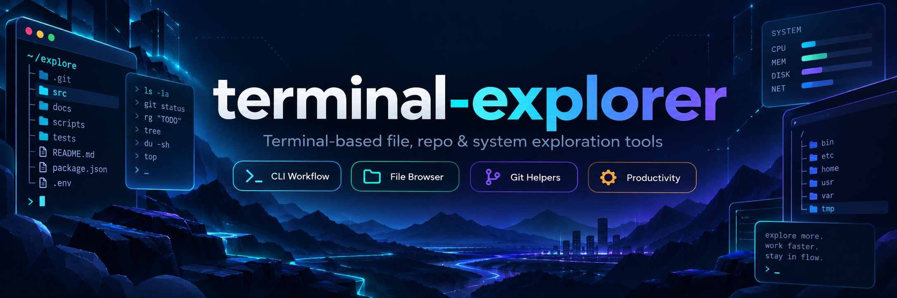

<!-- repo-banner:start -->
<p align="center">
  
</p>
<!-- repo-banner:end -->

# Terminal Explorer

[](https://github.com/baska-pro/terminal-explorer/releases/latest)
[](https://github.com/baska-pro/terminal-explorer/actions/workflows/ci.yml)
[](LICENSE)
[](#platform)


File manager interaktif untuk **Windows, Linux, Termux, dan macOS**. Linux/Termux menggunakan Bash + fzf; Windows/macOS menggunakan antarmuka Python native tanpa dependensi sistem tambahan.

> Current release: **v3.1.0**.

## Platform

Didukung:

- Termux / Android
- Windows 10/11 (PowerShell atau Command Prompt)
- macOS (terminal)
- Debian / Ubuntu
- Fedora / RHEL
- Arch Linux / Manjaro
- openSUSE
- Alpine Linux
- Void Linux
- Linux generic selama dependency tersedia

## Fitur

Di Linux/WSL/Termux, antarmuka Bash menyediakan:

- navigasi folder interaktif dengan `fzf`;
- preview file/folder/symlink;
- buat file dan folder;
- edit file;
- jalankan script/file executable;
- info file/folder;
- chmod;
- copy, cut, paste, move, rename, delete;
- clipboard internal;
- copy isi file ke clipboard sistem;
- bookmark;
- pencarian nama dan isi file;
- sort berdasarkan nama, ukuran, tanggal;
- hidden files;
- kompres dan ekstrak archive;
- deteksi Git repository;
- perlindungan path penting;
- `--doctor`, `--help`, dan `--version`.

Di Windows/macOS, antarmuka Python menyediakan navigasi bernomor, preview,
buat/edit/rename/delete file, copy/cut/paste, pencarian nama dan isi,
bookmark, urutkan item, tampilkan file tersembunyi, dan arsip ZIP.
Ketik `help` di dalam aplikasi untuk daftar perintah. Tampilan fzf,
clipboard sistem, dan operasi permission khusus Unix tersedia pada backend
Linux/Termux.

## Install melalui PyPI

Paket Python **`baska-explorer`** tersedia di PyPI. Pada instalasi baru, `pip install baska-explorer` memilih versi terbaru yang tersedia. Jika paket sudah terpasang, gunakan `pip install --upgrade baska-explorer` untuk memperbaruinya. `pip` memasang antarmuka Python dan skrip Bash, tanpa menjalankan installer GitHub, `sudo`, `apt`, atau `pkg`.

Persyaratan semua platform: Python 3.10+. Linux/WSL/Termux juga memerlukan Bash, fzf, tree, file, findutils, coreutils, awk, grep, sed, serta bat/batcat. Paket sistem dikelola oleh package manager OS. Setelah memasang dari PyPI di Linux/WSL/Termux, jalankan `baska-explorer --setup` untuk memasang hanya paket sistem yang belum ada; perintah ini menampilkan rencana dan meminta persetujuan. `--setup --yes` tersedia untuk penggunaan noninteraktif yang disengaja.

Windows native memakai antarmuka Python dan tidak membutuhkan Bash/fzf. Jika Python Windows sudah memiliki versi lama, perbarui dengan:

```powershell
py -m pip install --upgrade baska-explorer
baska-explorer --doctor
baska-explorer
```

Di WSL, jalankan perintah Linux di bawah dalam terminal Ubuntu. Instalasi Python Windows dan WSL terpisah.

Termux:

```bash
pkg install python
pip install baska-explorer
baska-explorer --setup
baska-explorer --doctor
baska-explorer
```

Debian/Ubuntu/WSL dengan Python sistem yang dikelola OS (PEP 668):

```bash
sudo apt update
sudo apt install -y pipx
pipx ensurepath
# Buka ulang terminal jika baska-explorer belum ditemukan di PATH.
pipx install baska-explorer
baska-explorer --setup
baska-explorer --doctor
baska-explorer
```

Perintah alternatif: `terminal-explorer` dan `texplorer`. Jika pernah memasang dengan `install.sh`, cek executable mana yang aktif melalui `command -v terminal-explorer` karena PATH bisa menunjuk instalasi lama. Jangan gunakan `--break-system-packages` untuk melewati PEP 668.

## Install cepat

### Termux / Linux

```bash
curl -fsSL https://raw.githubusercontent.com/baska-pro/terminal-explorer/main/install.sh | bash
```

Installer mendeteksi package manager:

```text
pkg
apt
dnf / yum
pacman
zypper
apk
xbps
```

### Dari clone

```bash
git clone https://github.com/baska-pro/terminal-explorer.git
cd terminal-explorer
chmod +x install.sh
./install.sh
```

## Jalankan

```bash
terminal-explorer
```

Alias:

```bash
texplorer
```

Buka folder tertentu:

```bash
texplorer ~/projects
```

Diagnostik:

```bash
texplorer --doctor
```

## Clipboard

Backend dipilih otomatis:

| Environment | Backend |
|---|---|
| Termux | `termux-clipboard-set` |
| Linux Wayland | `wl-copy` |
| Linux X11 | `xclip` |
| Linux X11 alternatif | `xsel` |

Clipboard sistem bersifat opsional. Clipboard internal copy/cut/paste tetap berfungsi tanpa backend tersebut.

## `bat` di Debian/Ubuntu

Pada sebagian versi Debian/Ubuntu executable paket `bat` bernama `batcat`.

Terminal Explorer mendeteksi keduanya otomatis:

```text
bat
batcat
```

Tidak perlu membuat symlink manual.

## Install path

Termux:

```text
$PREFIX/share/terminal-explorer/explorer.sh
$PREFIX/bin/terminal-explorer
$PREFIX/bin/texplorer
```

Linux:

```text
~/.local/share/terminal-explorer/explorer.sh
~/.local/bin/terminal-explorer
~/.local/bin/texplorer
```

Config:

```text
~/.config/terminal-explorer/
```

Jika bookmark lama ditemukan di:

```text
~/.config/termux-explorer/bookmarks
```

bookmark akan disalin otomatis saat config baru belum ada.


## Release

Versi stabil saat ini:

```text
v3.1.0
```

Lihat [GitHub Releases](https://github.com/baska-pro/terminal-explorer/releases/latest) untuk source archive dan asset release.

## Uninstall

```bash
./uninstall.sh
```

Hapus juga config:

```bash
./uninstall.sh --purge
```

## Safety

Sebelum delete, rename overwrite, move overwrite, dan operasi destruktif lain, aplikasi meminta konfirmasi.

Path penting seperti `/`, `/etc`, `/usr`, `/var`, `$HOME`, dan root Termux dilindungi dari operasi delete melalui menu.

Baca [docs/SAFETY.md](docs/SAFETY.md).

## License

BASKA-PRO PERSONAL USE LICENSE
Version 1.0

Copyright (c) 2026 Lathif Baska
All Rights Reserved.
